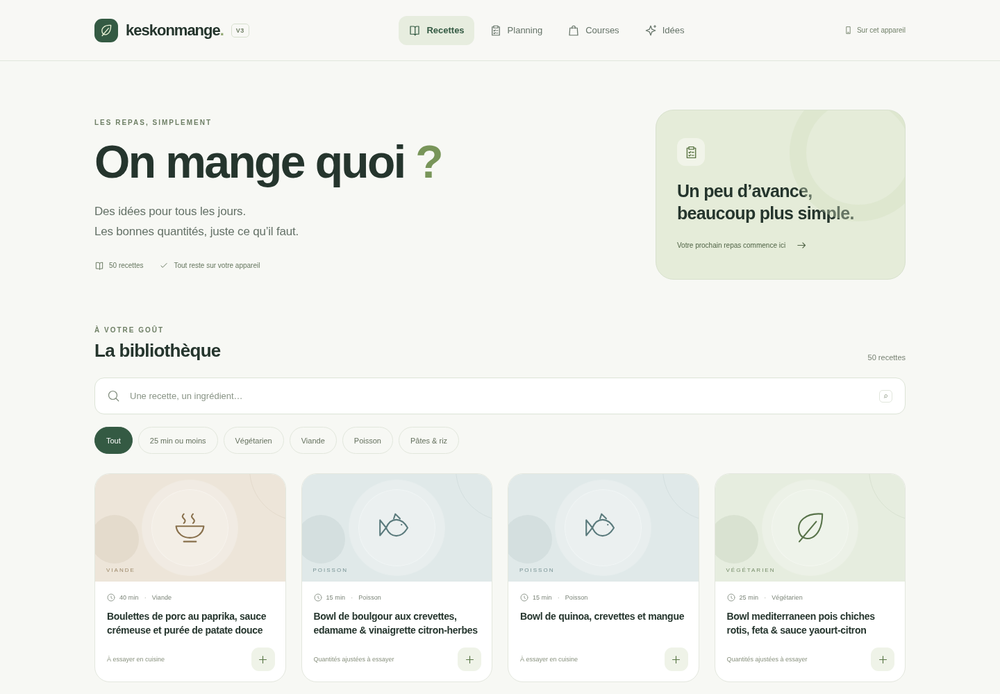

# KeskonMange V3 — Démonstration locale

Une application autonome, 50 recettes, un planning sans dates et des courses
regroupées. Aucun compte à créer, aucun prix fictif, aucun accès Firebase.

## Ouvrir l’application

1. Télécharger [KeskonMange-V3.html](app/dist/KeskonMange-V3.html). Sur GitHub,
   utiliser le bouton de téléchargement du fichier brut, en haut à droite.
2. Ouvrir ce fichier dans un navigateur récent avec JavaScript activé.
3. Choisir des recettes, régler les personnes puis les ajouter au planning.
   La liste de courses se calcule automatiquement.

Le fichier contient l’interface, les 50 recettes et le moteur : aucune installation
ou connexion n’est nécessaire pour les calculs. Les données sont enregistrées
dans le stockage local du navigateur, sur cet appareil. Garder le même fichier
et le même navigateur pour retrouver sa liste. Un navigateur privé ou un stockage
interdit ne garantit pas la reprise ; un message visible prévient de l’échec.

Le navigateur administré utilisé pour les tests interdit `file://`. Le même HTML
a donc été testé via HTTP local, sans changer cette politique. Si votre navigateur
est également administré et interdit les fichiers locaux, utiliser le serveur
local décrit ci-dessous ou demander à votre administrateur un mode d’ouverture autorisé.

## Parcours disponible

- **Recettes** : recherche par nom ou ingrédient, filtres et fiches recalculables.
- **Planning** : ajout, retrait et modification de chaque repas, sans dates.
- **Courses** : besoins regroupés, pièces arrondies après addition, cases conservées
  et articles libres. Une quantité cochée qui change demande une actualisation explicite.
- **Idées** : propositions sur demande ; ajout uniquement après un choix explicite.

Les quantités de démonstration ne sont pas des portions validées en cuisine.
Les adaptations sont signalées dans les fiches, avec les originaux et justifications.

[Inventaire des 50 recettes et réserves](library/INVENTORY.md) ·
[Rapport et limites](app/LOT5-REPORT.md) ·
[Mode d’emploi technique](app/README.md)

Les fichiers V1/V2 restent inchangés. Aucun déploiement ou transfert de données
utilisateur n’est réalisé par cette application.
